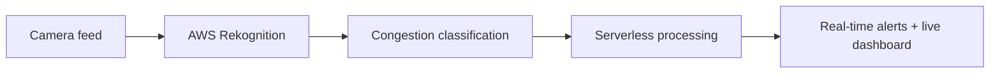

<!-- ============ HEADER ============ -->

<picture>
  <source media="(prefers-color-scheme: dark)" srcset="https://capsule-render.vercel.app/api?type=rect&color=090A16&height=190&section=header&text=KRITIK%20MAHESH%20KUMAR&fontSize=54&fontColor=F4F2FF&fontAlign=50&fontAlignY=44&desc=AI%20Engineer%20%C2%B7%20Builder%20%C2%B7%20Curious%20Mind&descSize=18&descAlign=50&descAlignY=72&animation=fadeIn" />
  <source media="(prefers-color-scheme: light)" srcset="https://capsule-render.vercel.app/api?type=rect&color=14122E&height=190&section=header&text=KRITIK%20MAHESH%20KUMAR&fontSize=54&fontColor=FFFFFF&fontAlign=50&fontAlignY=44&desc=AI%20Engineer%20%C2%B7%20Builder%20%C2%B7%20Curious%20Mind&descSize=18&descAlign=50&descAlignY=72&animation=fadeIn" />
  
</picture>

 

<a href="#main-quest"><b>Main Quest</b></a> &nbsp;·&nbsp; <a href="#quest-log"><b>Quest Log</b></a> &nbsp;·&nbsp; <a href="#skill-tree"><b>Skill Tree</b></a> &nbsp;·&nbsp; <a href="#achievements"><b>Achievements</b></a> &nbsp;·&nbsp; <a href="#player-telemetry"><b>Player Stats</b></a> &nbsp;·&nbsp; <a href="#enter-co-op-mode"><b>Co-op Mode</b></a>

 

## Player Profile

| | |
|:--|:--|
| **Name** | Kritik Mahesh Kumar |
| **Class** | AI & Machine Learning Engineer |
| **Origin** | Computer Science & Engineering |
| **Academy** | MAHE Dubai |
| **Base** | Dubai, United Arab Emirates |
| **Guilds** | Former GDSC & IEEE Core Team |
| **Status** | Open to AI/ML, GenAI & Software roles |

I build practical systems where **artificial intelligence, cloud computing, and software engineering** meet.

My focus is not just training models. I want to turn ideas into working products that can detect, predict, automate, and solve meaningful problems.

 

## Main Quest

> ### Build intelligent systems that create real-world value.

| Current mission | |
|:--|:--:|
| Explore Generative AI and autonomous agents | ▶ |
| Build cloud-native AI applications | ▶ |
| Apply computer vision to urban challenges | ▶ |
| Create useful developer tools | ▶ |
| Keep learning through projects and hackathons | ▶ |

<b>Inspect player background</b>

 

- Computer Science & Engineering Graduate from **MAHE Dubai**
- Focused on **AI, Machine Learning, and Generative AI**
- Building with **AWS and serverless cloud architecture**
- Interested in **Agentic AI, computer vision, and automation**
- Former core team member at **GDSC and IEEE**
- Based in **Dubai, United Arab Emirates**
- Open to opportunities across AI/ML and software engineering

 

## Quest Log

| Quest | Objective | Status |
|:--|:--|:--:|
| **TrafficIQ** | Transform CCTV feeds into real-time traffic intelligence |  |
| **Developer Behavior Plugin** | Explore developer workflows through a JetBrains IDE extension |  |
| **Agentic AI Lab** | Study autonomous workflows, secure agents, and AI applications |  |
| **ML Portfolio** | Build and document practical machine-learning models |  |

<b>Quest 01 &nbsp;·&nbsp; TrafficIQ</b>

### AI-Powered Traffic Intelligence

Cities already have thousands of cameras generating unused visual data. TrafficIQ explores how that existing infrastructure can become an intelligent congestion-monitoring network.

**Equipped stack** &nbsp; `AWS Rekognition` `Lambda` `DynamoDB` `SNS` `API Gateway`

**Quest outcomes**

- Classifies traffic as low, medium, or high congestion
- Sends alerts when congestion levels change
- Visualizes road conditions through a dashboard
- Uses existing infrastructure without requiring new roadside hardware

Developed during the **AI for Sustainability Hackathon 2026**.

<b>Quest 02 &nbsp;·&nbsp; Developer Behavior IDE Plugin</b>

### Understanding How Developers Work

A JetBrains IDE extension concept exploring how activity, interruptions, workflow consistency, and coding patterns can reflect a developer's working state.

**Quest focus** &nbsp; `JetBrains Platform` `IDE Extensions` `Developer Experience` `Product Design`

**Skills gained**

- Developer-centered product thinking
- IDE extension workflows
- Clean and maintainable implementation
- Rapid prototyping under hackathon pressure
- Collaborative debugging and iteration

Built for the **GDG on Campus: University of Birmingham Dubai Bounty Challenge**.

<b>Secret Level &nbsp;·&nbsp; Machine Learning Lab</b>

| Model | What it does | Stack |
|:--|:--|:--|
| **Tweet Sentiment Analysis** | Classifies tweets as positive, negative, or neutral using an NLP pipeline | `Python` `Scikit-learn` `NLTK` `Matplotlib` |
| **Customer Churn Prediction** | Identifies customers at risk of leaving using predictive classification | `Python` `Pandas` `Scikit-learn` `Matplotlib` |
| **MNIST Digit Recognition** | Recognizes handwritten digits using a trained neural network | `TensorFlow` `Keras` `NumPy` `Matplotlib` |

 

## Skill Tree

<table>
<tr>
<td width="200"><b>Intelligence & Data</b></td>
<td></td>
</tr>
<tr>
<td><b>Cloud & Backend</b></td>
<td></td>
</tr>
<tr>
<td><b>Languages & Apps</b></td>
<td></td>
</tr>
<tr>
<td><b>Systems & Tools</b></td>
<td></td>
</tr>
<tr>
<td><b>Design & Simulation</b></td>
<td></td>
</tr>
</table>

 

## Achievements

| | Achievement |
|:--:|:--|
|  | Computer Science & Engineering Graduate |
|  | Former GDSC Core Team Member |
|  | Former IEEE Core Team Member |
|  | AWS Learning Credential |
|  | Tata Generative AI Credential |
|  | AI for Sustainability Hackathon |
|  | GDG Bounty Challenge |
|  | **Building the next intelligent system** |

<b>Open achievement chest</b>

 

> Hackathons taught me that progress does not only come from winning.
> It comes from building under pressure, learning quickly, and leaving with better skills than you arrived with.

 

## Player Telemetry

<picture>
  <source media="(prefers-color-scheme: dark)" srcset="https://streak-stats.demolab.com?user=KritikMahesh&hide_border=true&background=090A16&stroke=33335A&ring=5B3FD9&fire=6C9CFF&currStreakNum=F4F2FF&sideNums=F4F2FF&currStreakLabel=A08BFF&sideLabels=A9A8C8&dates=7E7CA0" />
  <source media="(prefers-color-scheme: light)" srcset="https://streak-stats.demolab.com?user=KritikMahesh&hide_border=true&background=F5F4FC&stroke=D3D1EA&ring=5B3FD9&fire=2F5BEA&currStreakNum=14122E&sideNums=14122E&currStreakLabel=5B3FD9&sideLabels=55537A&dates=6F6E93" />
  
</picture>

<picture>
  <source media="(prefers-color-scheme: dark)" srcset="https://github-readme-activity-graph.vercel.app/graph?username=KritikMahesh&bg_color=090A16&color=A9A8C8&title_color=F4F2FF&line=6C9CFF&point=F4F2FF&area=true&area_color=5B3FD9&hide_border=true&custom_title=Player%20activity" />
  <source media="(prefers-color-scheme: light)" srcset="https://github-readme-activity-graph.vercel.app/graph?username=KritikMahesh&bg_color=F5F4FC&color=55537A&title_color=14122E&line=2F5BEA&point=14122E&area=true&area_color=A08BFF&hide_border=true&custom_title=Player%20activity" />
  
</picture>

 

## Enter Co-op Mode

Have an AI idea, engineering challenge, hackathon, or project worth building?

  

